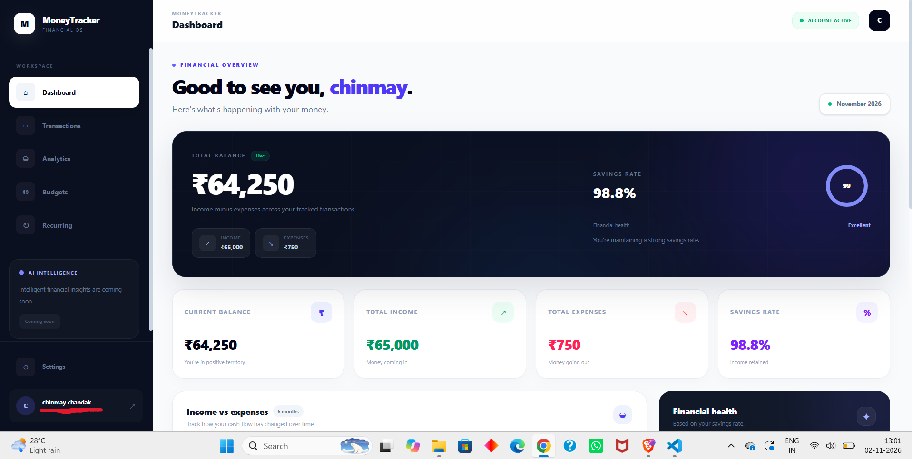
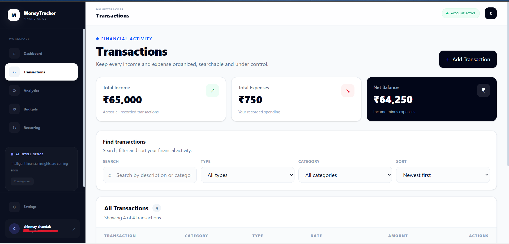
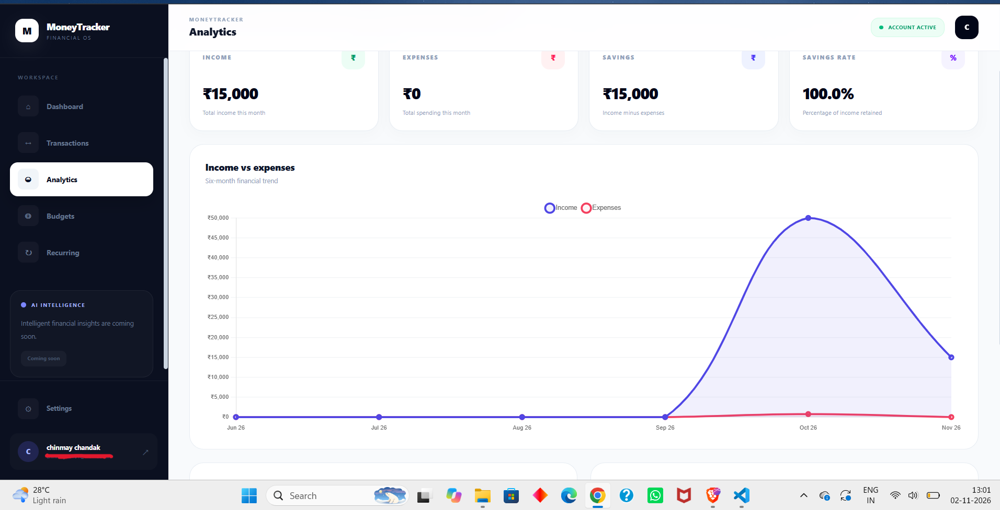

# Where Is My Money Going?

A full-stack personal finance tracker for managing income, expenses, budgets, recurring transactions, and spending analytics.

## Screenshots

### Dashboard



### Transactions



### Analytics



## Features

- User registration and login with JWT authentication
- Protected user-specific routes
- Create, edit, delete, and view transactions
- Income and expense tracking
- Budget management
- Recurring transaction management
- Financial dashboard and analytics
- Monthly spending insights and charts
- Responsive React interface
- MongoDB persistence through Mongoose

## Tech Stack

**Frontend:** React, Vite, Tailwind CSS, React Router, Chart.js

**Backend:** Node.js, Express.js, REST APIs

**Database:** MongoDB, Mongoose

**Authentication:** JWT, bcryptjs

## Project Structure

```text
where-is-my-money-going/
├── src/                 # React frontend
│   ├── components/
│   ├── context/
│   ├── pages/
│   └── services/
├── backend/             # Express REST API
│   ├── config/
│   ├── controllers/
│   ├── middleware/
│   ├── models/
│   └── routes/
├── public/
├── package.json
└── README.md
```

## Getting Started

### 1. Clone the repository

```bash
git clone https://github.com/<your-username>/where-is-my-money-going.git
cd where-is-my-money-going
```

### 2. Install frontend dependencies

```bash
npm install
```

### 3. Configure the backend

```bash
cd backend
npm install
```

Create a `.env` file using `.env.example` as a template:

```env
PORT=5000
MONGO_URI=your_mongodb_connection_string
JWT_SECRET=your_secret
FRONTEND_URL=http://localhost:5173
```

### 4. Start the backend

```bash
npm run dev
```

### 5. Start the frontend

From the project root:

```bash
npm run dev
```

The frontend runs on the Vite development server and communicates with the Express API.

## Security

Environment files containing database credentials and JWT secrets are intentionally excluded from version control. Never commit real credentials to GitHub.

## Future Improvements

- Deployment with a production database and frontend/backend hosting
- More advanced spending insights
- Exportable financial reports
- Additional financial visualizations
- AI-powered spending analysis

## Author

Chinmay Chandak
